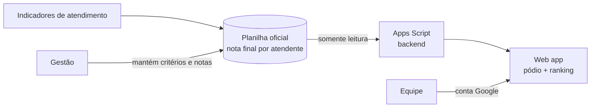

# Arena de Atendimento: ranking gamificado da equipe

Web app que transforma a planilha oficial de desempenho da equipe de atendimento em um **ranking visual em formato de gincana**, com pódio e pontuação individual, para dar transparência aos indicadores e engajar a equipe.

**Status:** em produção · **Stack:** Google Apps Script (web app) + Google Sheets · **Meu papel:** ideia, desenho da experiência, desenvolvimento e implantação

> Documentação conceitual. Sem código, dados reais, nomes de pessoas ou identificação da organização.

---

## O problema

O desempenho de cada atendente já era calculado, mas ficava **dentro de uma planilha**, que poucos abriam e que é difícil de ler rápido. Resultado:

- A equipe não tinha visibilidade de como estava indo ao longo do mês.
- O reconhecimento dos melhores resultados dependia de alguém lembrar de comunicar.
- O indicador existia, mas não **motivava** ninguém.

## A solução

Uma página web, acessada com a conta corporativa, que lê a **nota final de cada atendente direto da planilha oficial** e mostra:

- **Pódio** com os três primeiros colocados e suas pontuações;
- **Ranking individual** de toda a equipe pela nota final;
- Identidade visual de **gincana**, com mascote e linguagem leve, para o ranking ser visto como jogo coletivo e não como cobrança.

## Arquitetura

**Princípio central:** o app **não calcula nem altera notas**. Ele só lê a planilha oficial mantida pela gestão. Assim existe **uma única fonte de verdade** e ninguém discute o número exibido na tela.

## Decisões de design

| Decisão | Por quê |
|---|---|
| Leitura direta da planilha oficial, sem cópia | Evita divergência entre o que a gestão calcula e o que a equipe vê. |
| Acesso só com conta corporativa | O ranking é informação interna da equipe. |
| Linguagem de gincana (pódio, pontos, mascote) | Reconhecimento público positivo engaja mais do que uma tabela de notas. |
| Destaque para o topo, não para o fim da lista | O objetivo é inspirar, não expor quem está abaixo. |

## Cuidados de gestão

Ranking de pessoas é uma ferramenta poderosa e pede cuidado:

- **Critérios claros e conhecidos:** a equipe precisa saber como a nota é formada.
- **Indicador equilibrado:** medir só volume incentiva pressa; a nota deve combinar produtividade e qualidade.
- **Uso para desenvolvimento:** o ranking abre conversas de feedback e reconhecimento, não substitui a avaliação individual.

## Governança e boas práticas

- **ITIL:** gestão da força de trabalho e talentos (reconhecimento e desenvolvimento) e melhoria contínua.
- **COBIT, MEA01:** monitoramento de desempenho com indicadores transparentes.
- **Gestão de pessoas:** transparência de critérios e reconhecimento público como alavancas de engajamento.

## O que aprendi

- **Visibilidade muda comportamento:** um indicador que ninguém vê não motiva ninguém; a forma de apresentar importa tanto quanto o cálculo.
- Em ferramentas de desempenho, **confiança no dado** vem antes do design.
- Gamificar exige equilíbrio: a experiência precisa ser leve sem banalizar a avaliação.

---

## Outros estudos de caso

- [Pesquisa de satisfação (NPS) pós-visita técnica](https://github.com/alexpernaoficial/pesquisa-nps-atendimento)
- [Gestão de escalas e folgas](https://github.com/alexpernaoficial/gestao-escalas-folgas)
- [Programa de treinamento e integração](https://github.com/alexpernaoficial/treinamento-integracao-suporte)

## Sobre mim

**Alex Perna**, suporte técnico N2 e liderança de equipe em provedor de internet (ISP). Estudando ITIL, COBIT 2019 e ISO/IEC 27001, e cursando Ciência da Computação.

[LinkedIn](https://www.linkedin.com/in/alexpernaoficial/)
